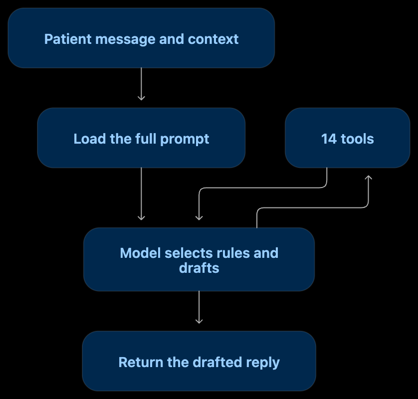
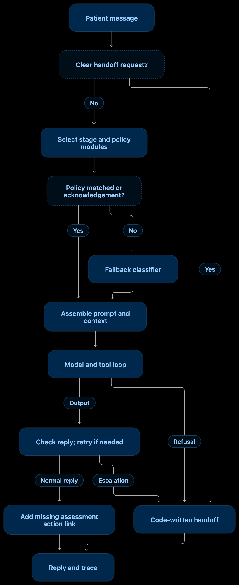
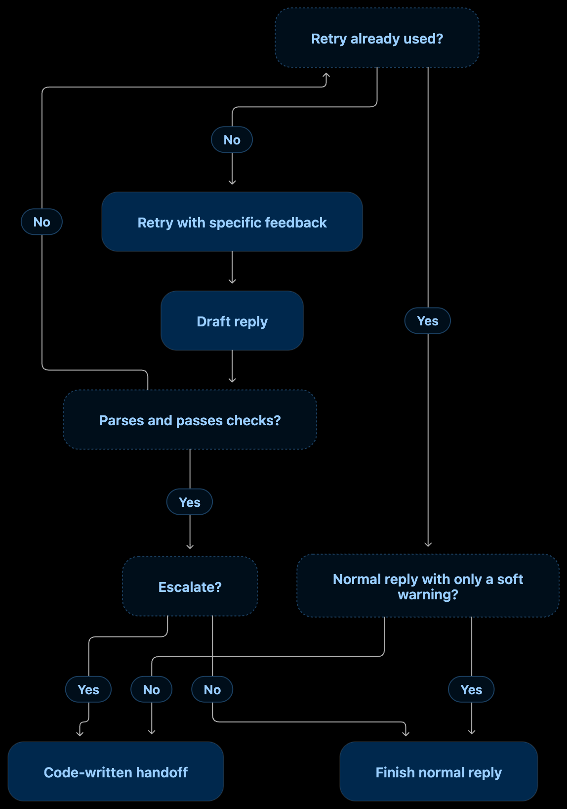

# Doctours reply system

Doctours drafted every patient SMS reply from one 800-line prompt. That prompt loaded every rule on every message and had no way to hand a conversation to a person.

This repository replaces it with a pipeline where **code decides and the model drafts**. Code:

- picks the rules each message needs and settles conflicts between them,
- checks every reply against what the tools returned,
- hands the conversation to a person when one must take over.

The policy text itself is unchanged: it is the original prompt's wording, cut into modules.

<p align="center"><br><sub>The original flow: one prompt, and the model chooses its own rules.</sub></p>

## Results

| | Original prompt | This system |
|---|---|---|
| Escalation stress set (60 cases, blind) | 67.8% | **96.7%** |
| Robustness set (60 cases, blind) | 78.3% | **90.6%** |
| Messages that need a person, handled correctly (blind sets) | 7–8% | **100%** |
| Median latency (all five test sets) | 5.2–6.9 s | **3.6–4.9 s** |
| Cost per 1,000 replies (all five test sets) | $1.78–2.03 | **$0.81–1.18** |

The gain is in handoffs, speed and cost. On ordinary questions that should not escalate, the two systems are within noise of each other.

**What it was tested on.** Both systems ran on the same model, tools, patient data and conversation, three times per case, scored by code. There were five test sets, 372 cases in total:

| Set | Cases | Written by | Blind? |
|---|---|---|---|
| Dev | 107 | Built from the original prompt's rules and examples; includes the brief's five sample messages | No, the system was tuned on it |
| Held-out | 25 | Another model, from the brief only | Only for its first run |
| External | 120 | Another model, from the brief only | Only for its first runs |
| Escalation stress | 60 | Another model, from the brief only | Yes, scored once on the frozen system |
| Robustness | 60 | Another model, from the brief only | Yes, scored once on the frozen system |

Every case uses the brief's single patient and conversation. The two blind sets, stress and robustness, are the headline numbers above. Every run is saved in [`results/runs/`](results/runs/).

## Quick start

**You need:** Node 20 or later and an Anthropic API key. The default model is Haiku 5.5.

```bash
git clone https://github.com/SoHarshh/DOCTOURS-harsh.git
cd DOCTOURS-harsh
npm install
echo "ANTHROPIC_API_KEY=sk-ant-..." > .env
npm run -s reply -- --in messages.json --out replies.json
```

`messages.json` is a JSON array of messages:

```json
[
  { "id": "1", "text": "How much is the Silver package at Heva?" },
  { "id": "2", "text": "I want to talk to a real person" }
]
```

The output is a JSON array of `Reply` objects, one per message, in the same order. Each message is answered as an independent turn on the brief's patient and conversation.

- Without `--in`, input is read from standard input. Without `--out`, replies go to standard output.
- Keep `-s` so npm's banner stays out of the JSON.
- A trace for each reply goes to `results/traces.jsonl`.
- `--concurrency N` sets how many messages run at once (the default is 4).
- `--system baseline` runs the original prompt instead.
- `npm test` runs the unit tests and needs no API key.

## How it works

<p align="center"></p>

Code catches clear handoffs, picks the rules, and assembles the prompt. The model drafts with the same 14 tools. Code then checks the reply against the tool results, allowing one retry:

<p align="center"></p>

- **Why this structure.** A small model follows fewer rules as their number grows, and it handles conflicting rules poorly. So decisions that can be tested move into code, and the model sees only the rules a message needs.
- **What stays loaded on every turn.** The core prompt ([`prompts/core.md`](prompts/core.md)) and the patient context. The rest is the patient's stage module plus at most 3 of the 30 policy modules in [`skills/`](skills/).
- **How escalation works.** Escalation can come from three places: the pre-gate (asks for a person, card details), the model (a short fixed list in the core prompt), or the checks (a hard failure after the retry). In every case code writes the one-sentence handoff.

Every step, the full escalation list, and the reasons behind each choice are in [`docs/how-it-works.md`](docs/how-it-works.md).

## More detail

- [`docs/how-it-works.md`](docs/how-it-works.md): the full explainer: each step and why it exists, escalation in full, how it was evaluated, results, and how it evolved
- [`docs/decisions.md`](docs/decisions.md): every decision in order, with the reason and the numbers
- [`docs/research/`](docs/research/): the research behind the design
- [`results/runs/`](results/runs/): every measured run, with comparison tables and audits
- [`tests/`](tests/): the five test sets and the unit tests
