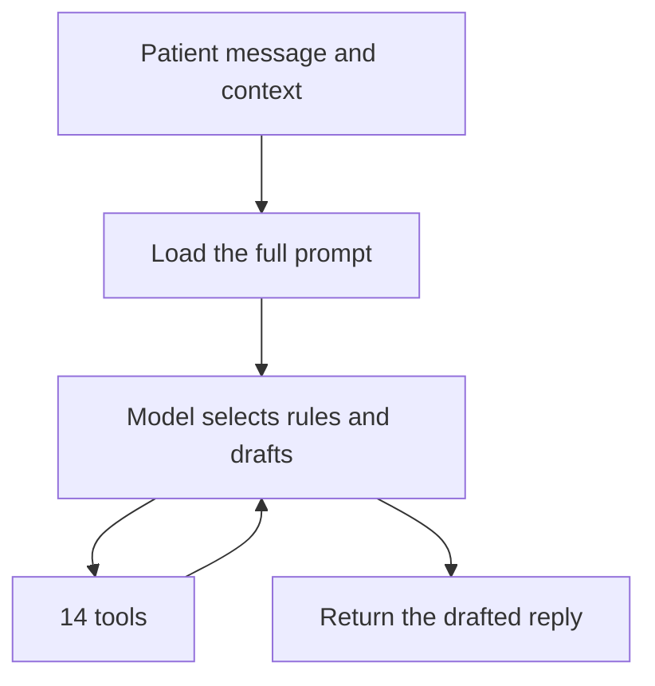
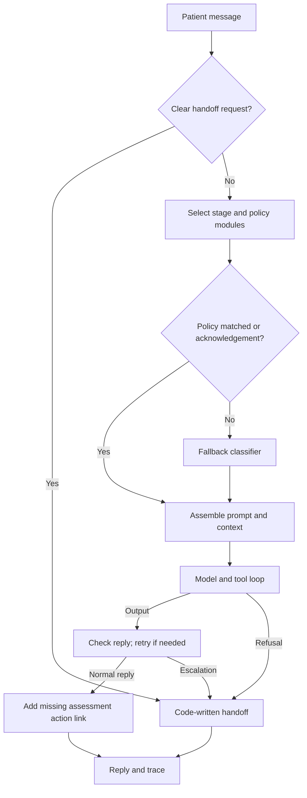
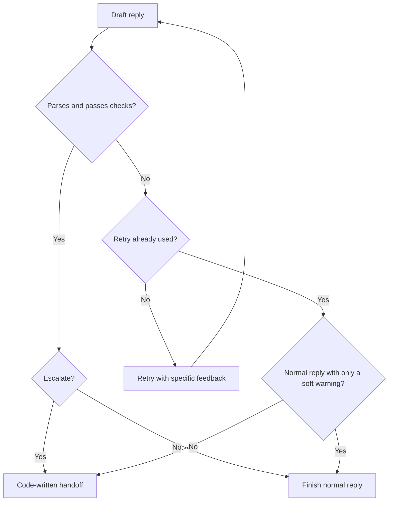

# How the Doctours reply system works

How a patient message becomes a reply, what changed from the original system, and what the evaluation shows.

## 1. What it is

Doctours helps patients arrange hair transplants in Istanbul. Its AI coordinator, Alex, drafts SMS replies before a patient pays a deposit.

The original system used one roughly 800-line prompt for every message. This project replaces it with a pipeline: code selects the relevant rules, the model drafts with tools, and code checks the reply. When a person must take over, the system stops and returns a short handoff.

The command takes a JSON array of `{id, text}` messages and returns structured `Reply` objects in the same order:

```bash
npm run -s reply -- --in messages.json --out replies.json
```

Each reply includes the patient-facing text, escalation flag and reason, follow-up settings, and any working-memory updates. Setup instructions are in [README.md](../README.md).

## 2. What stays the same

Both systems use Haiku 5.5, the same 14 tools and fixture data, the same patient context, structured output format and caching. The change is how rules are selected and enforced.

Each message is an independent turn on the same fixed history: Jordan Hale has received an assessment recommending Heva and Dr. Hakan. The tools provide clinic facts, prices, patient details and links; they are assignment fixtures, not live clinic integrations.

Policy modules preserve the original wording; five lines that contradicted the new handoff requirement were removed (listed in the decision log). A separate fertility stub demonstrates how another care line could be added.

## 3. Original flow



Every turn loads every policy, stage and example. The model must choose which rules matter, resolve conflicts, call tools and write the response. There is no separate policy router or validation pass.

This makes failures hard to trace and policy changes hard to isolate. It also does not reliably enforce the new escalation requirement: in evaluation, the model sometimes set the escalation flag but kept answering the sales question.

The baseline wrapper still provides parsing, measurement and technical fallbacks for refusal or invalid output. Those are separate from policy-based escalation.

## 4. New flow, step by step



### Catch clear handoffs

The **pre-gate** checks for explicit human requests, shared card details and instructions to charge a card. Clear cases end here without a model call, making them fast and repeatable.

### Select the relevant rules

The **router** loads the patient's stage module and up to three policy modules. It resolves declared conflicts before loading them. For example, a request to pause suppresses the usual collection prompt instead of leaving the model to reconcile both instructions.

If no policy matches and the message is more than an acknowledgement, a small **fallback classifier** picks modules from their descriptions. This covers unfamiliar wording without adding a classification call to every message. Its choices use the same conflict rules and module cap. If it fails, the pipeline continues with the rules already selected.

### Assemble and draft

Code combines the core instructions, selected modules and patient context. Haiku 5.5 then calls the tools it needs and drafts a structured reply. One drafting attempt can contain several tool/API rounds; it is not necessarily one API request.

### Check and finish

Code checks the draft and allows one corrective attempt when needed. If a normal reply directs the patient to act on their assessment but omits its link, code fetches and appends it. This fixes an instruction the model followed inconsistently without needing another model call.

### Record the path

The system returns the reply and a **trace**: which modules loaded and why, which rules were suppressed, tools called, failed checks, retries, escalation source, token usage and latency. A developer can follow a bad reply back to the decisions that produced it.

The implementation starts in [src/pipeline/runMessage.ts](../src/pipeline/runMessage.ts).

## 5. Checks and the retry

Code fixes basic formatting first, then checks the reply for:

- Unsupported links or prices, and card digits repeated back to the patient.
- False claims that information was saved, a link sent or a human contacted.
- Banned promises, incorrect output fields and invalid attachments.
- Package or price claims made without the expected tool lookup.

The checks allow explicit policy exceptions, such as fixed links. They are targeted checks, not proof that every statement is correct.



The retry receives specific feedback, including allowed URLs and prices for validation failures. After that one attempt, an unparseable reply or a remaining hard failure goes to a person.

There is one soft exception: `toolRequired`, the warning about a missing package lookup. If that is the only remaining failure and the reply is not escalating, it is sent with the warning recorded. This avoids unnecessary handoffs caused by a heuristic. All other remaining failures are hard.

The full rules are in [src/pipeline/validators.ts](../src/pipeline/validators.ts).

## 6. Escalation

Policy escalation is decided in three places: **the pre-gate** catches clear requests, **the model** handles cases requiring context, and **the checks** catch unacceptable output after retry.

| Where | Needs a person | Gets a normal answer |
| --- | --- | --- |
| Pre-gate; also stated in the model's rules | Explicit request for a human, agent or manager | Identity questions, talking to family, asking about past patients |
| Pre-gate; also stated in the model's rules | Shared card details or a request to charge a card | Payment-method questions, recurring-billing questions, self-service payment links |
| Model | Move, transfer or refund money the patient says they paid to Doctours, even if none appears on file | Hypothetical refund/transfer terms; questions about deposits paid directly to a clinic |
| Model | Contact a clinic or hold/reserve a date | Supported self-service booking questions |
| Model | Check which clinic dates are open | Ask which weekdays a package can be booked on |
| Model | Arrange or change a hotel, transfer or driver | Ask how transport works, about extra hotel nights or flight help |
| Model | A second request for clinic phone, WhatsApp or email after the first was answered | A first request for those details |
| Model | Persistent demand for an unverifiable discount after hearing the current price | Ordinary pricing questions or a verified active promotion |
| Model | A separate callback or call with Alex, the surgeon or clinic | Questions, booking or rescheduling covered by the free consultation |
| Checks | A hard failure remains after retry | Only the soft warning described above remains |

Uncertainty alone is not a reason to escalate. The answerable look-alikes matter: broad escalation rules can send ordinary questions to a person unnecessarily.

Every escalation ends with **one sentence written by code**, a true escalation flag and a short reason. The system does not continue the sales answer or repeat card digits. Model refusals and repeated processing errors also have fallback handoffs.

The policy is in [prompts/core.md](../prompts/core.md); clear-request detection is in [pregate.ts](../src/pipeline/pregate.ts).

## 7. What stays loaded every turn

For turns that reach the main model, the prompt has three cached blocks:

| Block | Contents |
| --- | --- |
| Core | About 1,400 words: identity, voice, scope, grounding, escalation and output rules |
| Selected modules | The patient's stage and up to three relevant policies |
| Patient context | Patient details, clinic flags, collection status, working memory, calls and conversation |

The core and patient context are always present; the policy selection changes with the message. All 14 tools remain available.

The repository has six stage modules and 24 policy modules. Call summaries are prepared ahead of time and included only when relevant. There is no call-summary agent running inside the live reply path. Pre-gated turns skip the model entirely.

## 8. Why this structure

The brief's eight problems map directly to the design:

| Problem | Response |
| --- | --- |
| Every rule loads every turn | Route to a small set of relevant modules |
| A bad reply cannot be traced to a rule | Record routing, tools and checks in a trace |
| New care lines collide with existing rules | Give each line its own modules and tests; fertility is a stub |
| Subtasks have nowhere to go | Prepare call summaries separately |
| Every message pays for the full prompt | Reduce context, cache shared blocks and skip the model for clear handoffs |
| Policy edits affect unrelated replies | Isolate policy text; use the blast-radius command to find affected tests |
| Rule conflicts have no recorded winner | Resolve declared conflicts in code and log the result |
| One behavior cannot be tested alone | Test modules, checks and escalation rules separately |

Some conflicts still depend on tool data or conversation history and remain with the model. The design moves enforceable decisions into code without pretending every judgment can be reduced to a rule.

The rationale and evidence are in [docs/decisions.md](decisions.md) and [docs/research/](research/).

## 9. How it was evaluated

Both systems ran under the same conditions, with **three runs per case** and deterministic code scoring.

| Set | Cases | Author/source | Blind status |
| --- | --- | --- | --- |
| Dev | 107 | Project cases from the original rules, examples and tool data | Tuned on |
| Held-out | 25 | Separate model, brief only | Blind on the first run; later used for fixes |
| External | 120 | Different model, brief only | Blind on the first runs; later used for fixes |
| Escalation stress | 60 | Separate model, brief only | Blind through the frozen run |
| Robustness | 60 | Separate model, brief only | Blind through the frozen run |

There are **372 cases**, including the five brief samples inside dev, giving 1,116 turns per system. A turn passes only if all its checks pass: escalation, required and forbidden content, formatting, applicable follow-up fields and required tool calls.

The comparison pairs the systems by case and reports the mean pass-rate difference with its standard error. It also reports escalation errors, tool-use failures, retries, latency and cost. Infrastructure errors are tracked separately and excluded from scored results.

Four safeguards make the results more useful:

- **Check the checks:** every case in the four extra sets has a correct reply that must pass and a wrong reply that must fail.
- **Prevent leakage:** tests reject normalized six-word overlaps with the brief's expected replies in prompts, modules and cases. Shared URLs are excluded; the full comparison requires the local brief.
- **Separate testing from tuning:** blind sets were scored before changes motivated by their failures. Later fixes are disclosed, and escalation triggers have answerable look-alikes.
- **Audit the scores:** an independent review rescored the final external, stress and robustness outputs with no mismatches and inspected failures and passing replies. False passes were below 5% and did not change the overall comparison.

Details are in the [final audit](../results/runs/final/audit.md). Test cases and scoring code are in [tests/](../tests/) and [harness/](../harness/).

## 10. Results

The main comparison uses the frozen system, **8ec6390**, on the two sets it had not been tuned on:

| Blind set | Original | New | Difference, percentage points |
| --- | --- | --- | --- |
| Escalation stress | 67.8% | 96.7% | +28.9; SE 6.5 |
| Robustness | 78.3% | 90.6% | +12.2; SE 5.4 |

**The gain is mainly in handoffs.** On blind cases requiring escalation, the new system passed all checks in 100% of turns. The original often set the flag but continued answering. Ordinary-answer quality did not measurably improve; the original was slightly ahead within the reported noise.

Speed and cost also improved. These are the minimum-to-maximum values across the five frozen test sets:

| Metric | Original | New |
| --- | --- | --- |
| Median latency | 5,214–6,853 ms | 3,620–4,889 ms |
| p95 latency | 9,397–12,428 ms | 6,792–9,009 ms |
| Mean prompt size | 167,048–167,133 characters | 39,923–47,542 characters |
| Cost per 1,000 turns | $1.78–$2.03 | $0.81–$1.18 |

Latency and prompt size cover turns that reached the model. Cost includes all turns, including pre-gated handoffs. The new system was faster and cheaper on every set; the individual measurements are in the five [final comparison tables](../results/runs/final/).

Later fixes in **f5e2652** raised stress to 100% and robustness to 91.1%. Those reruns are **not blind** and do not replace the frozen headline. Full results are in [results/runs/postfreeze/](../results/runs/postfreeze/).

## 11. How it evolved

| Stage | What changed and why |
| --- | --- |
| Original | One prompt handled all rule selection and drafting |
| v1 | Added routing, modules, checks, bounded retry, code-written handoffs and traces to make behavior testable; moved inconsistent assessment-link inclusion into code after the first live run |
| v2 | Fixed routing misses, false validator failures and caching |
| v3 | Added fallback classification after blind held-out messages exposed gaps in phrase matching |
| Generalization | Expanded escalation coverage with look-alikes, separated hard and soft failures, and improved module descriptions; rejected always-on classification because it added latency without enough benefit |
| Frozen: 8ec6390 | Evaluated the fixed system on the two untouched blind sets |
| Post-freeze: f5e2652 | Refined past-patient exclusions, refund-terms questions and pauses inside multi-question messages |

These were iterative changes, not controlled tests of one component at a time. The [decision log](decisions.md) records each choice, its reason, and the results used to judge it.

## 12. Limits

Text checks cannot fully judge tone or establish that every factual claim is supported. Known errors include repeated closing questions, unsupported recovery advice and occasional omitted price or package details. Callback requests and demands to move deposits paid directly to clinics also expose ambiguities in the brief.

The command uses one fixed patient and independent turns. This does not establish broad production performance. A real deployment still needs live integrations, a staffed inbox and persistent thread ownership: this repository returns an escalation flag; it does not itself dispatch the conversation to a human.

## 13. Where to find more

- [README.md](../README.md): installation and commands.
- [docs/decisions.md](decisions.md): decisions, alternatives and reasons.
- [docs/research/report.md](research/report.md) and [notes/](research/notes/): evidence behind the design.
- [src/pipeline/](../src/pipeline/), [prompts/](../prompts/) and [skills/](../skills/): implementation and rules.
- [results/runs/packet/](../results/runs/packet/): sample-message replies and traces.
- [results/runs/final/](../results/runs/final/): frozen outputs, audit and `*-compare.md` tables.
