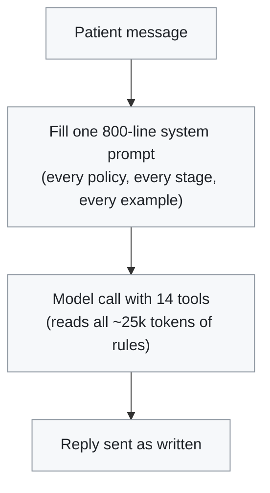
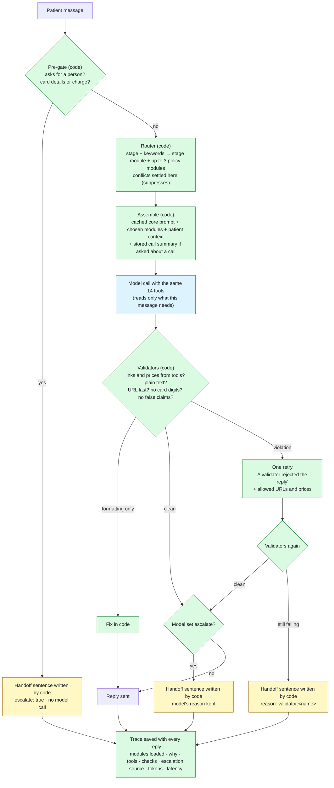

# Workflow: original vs new

Both diagrams show what happens for one patient message.

## Original: one prompt does everything

What is missing: no way to hand off to a person, no check on the reply before it is sent, no record of which rules were involved, and every message pays for every rule.

## New: code decides, the model drafts

Green is new code. Blue is the one model call, the same model and tools as before. Yellow is a handoff to a person.

## What each new piece does

| Piece | What it does | Which packet problem it answers |
|---|---|---|
| Pre-gate | Catches clear handoff requests and card details before any model call | Escalation; 5 (no cost for these) |
| Router | Loads only the modules this message needs; settles rule conflicts in code | 1, 5, 6, 7 |
| Policy modules | The original policy text, cut into one file per policy, each with its own tests | 3, 6, 8 |
| Cached core prompt | The short part every message needs; identical bytes every time so the API caches it | 5 |
| Validators and one retry | Check the reply against what the tools returned; retry once with the allowed values | Output quality |
| Code-owned handoff | Code writes the handoff sentence, so it never answers the question or pretends work was done | Escalation |
| Call summary | Prepared once per call ahead of time; added only when the patient asks about a call | 4 |
| Trace | Records what code decided and why for every reply | 2 |

## Done ahead of time, not per message

Cutting the prompt into modules, writing tests, running evals, and summarizing call transcripts all happen before any patient texts. Per message there is code, one model call (two only when a check fails), and code.
